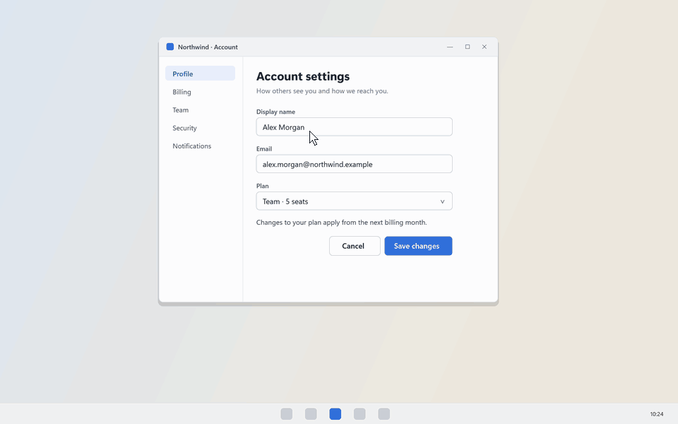
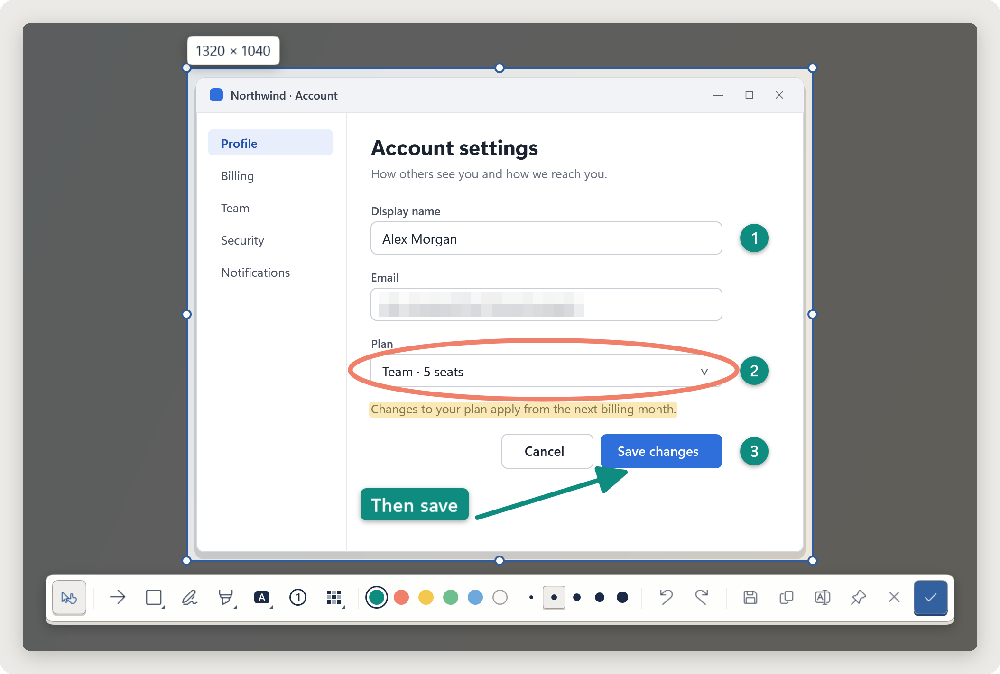
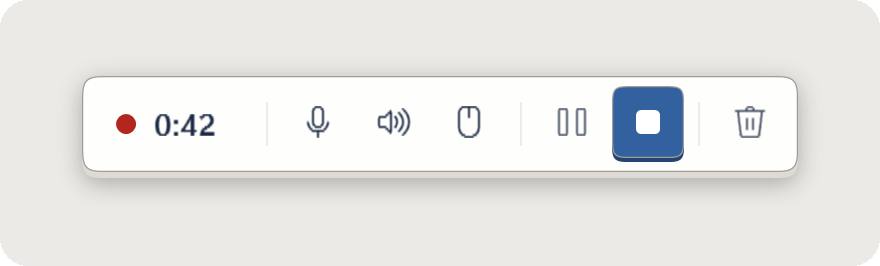
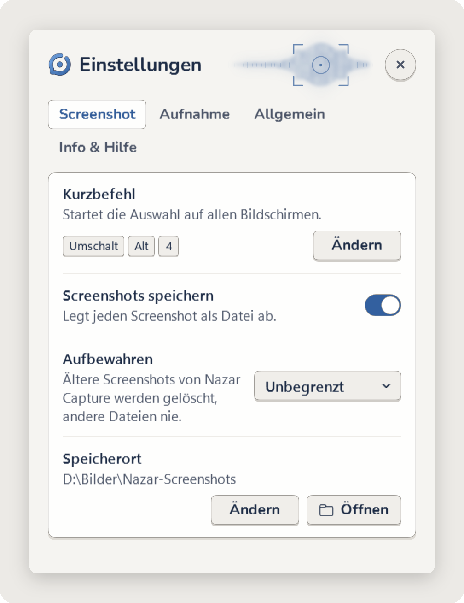
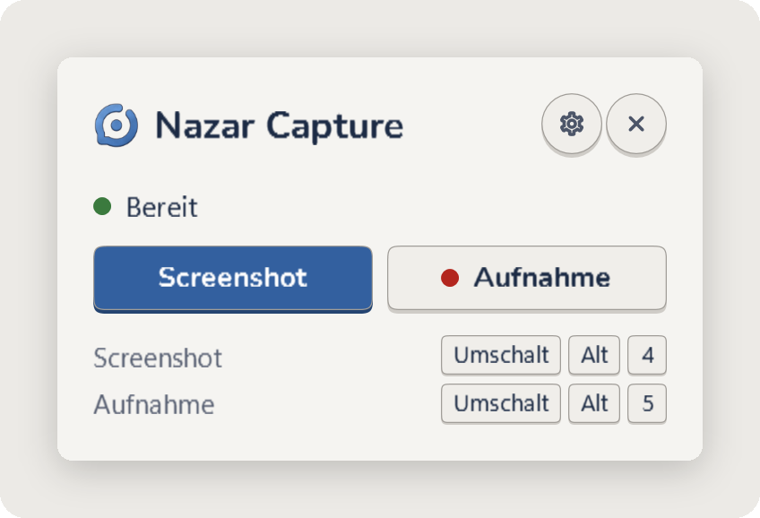

<p align="center">
  
</p>

<h1 align="center">Nazar Capture</h1>

<p align="center">
  <b>Keyboard-first screenshots and screen recordings for Windows.</b><br>
  Press a hotkey, drag an area, and the screenshot is on the clipboard and saved as PNG, with an annotation editor,
  offline text recognition and GPU screen recording one click away.
</p>

<p align="center">
  <a href="https://github.com/Mosaik114/nazar-capture/actions/workflows/ci.yml"></a>
  <a href="https://github.com/Mosaik114/nazar-capture/releases/latest"></a>
  
  
  <a href="LICENSE"></a>
</p>

<p align="center">
  
  <br>
  <sub>Drawn by the app's own overlay and card code; the desktop behind it is a mock-up, pointer and key caps are added.</sub>
</p>

<p align="center">
  <b><a href="https://github.com/Mosaik114/nazar-capture/releases/latest">Download Nazar Capture for Windows</a></b>
  (installer, no admin rights, no runtime to install) · <a href="#install">Install</a> · <a href="docs/architecture.md">Architecture</a>
</p>

> **Use it**
> 1. Press **`Shift+Alt+4`**, drag an area (or click a window, or press `Space` for the whole monitor): it is copied
>    and saved. The card offers *Bearbeiten* (edit), *Anpinnen* (pin), *Text*, folder and delete.
> 2. Press **`Shift+Alt+5`** to record an area with system sound and microphone; press it again to stop.
> 3. Everything else is behind the tray icon: main window, settings, help.

The interface speaks German, English, Russian, Spanish, French, Arabic (right to left) and Turkish, or follows the
Windows language (*Automatisch*); code, docs and commit history are in English.

## Highlights

- **Instant capture.** The screen is frozen first, so menus and tooltips stay put. A loupe shows the pixels under
  the pointer; the overlay spans all monitors, also very wide ones such as 5120 × 1440, and works with the arrow keys.
- **Annotation editor.** Arrows, shapes, pen, highlighter, spotlight, text plates, numbered steps, pixelate and blur.
  A rough pen stroke held still snaps into a clean line, arrow or shape; the highlighter snaps to text lines.
- **Offline text recognition.** *Text* copies the text in a capture with the Windows OCR engine on your machine.
- **Screen recording.** GPU capture through ffmpeg (NVENC, with a software fallback), system sound and microphone on
  separate tracks that stay in sync across pauses, then trim and export as MP4 or GIF.
- **Keep it or not.** Every capture goes to the clipboard; saving it as a file can be switched off, and old captures
  of Nazar Capture can be deleted after 7, 30, 90 days or a year (other files in the folder are never touched).
- **Small and quiet.** A native tray app keeps the hotkeys; the capture engine starts on the first capture and is
  prepared in the background after logon. No telemetry; the only network call is a daily, read-only update check
  that you can switch off.

<p align="center"><br><sub>The editor: steps, pixelate, a pen ellipse that snapped into shape, highlighter and a labelled arrow.</sub></p>

<p align="center"><br><sub>While recording: time, microphone, system sound, clicks, pause, stop, discard.</sub></p>

## For reviewers

If you have five minutes, this is what the project shows:

| | Where to look |
|---|---|
| **Architecture:** a small Rust host for hotkeys, tray and settings file; a C#/WPF engine for everything visual; one contract file that both test suites check | [Architecture](docs/architecture.md#why-split-it-this-way), [contract](contract/contract.json) |
| **Hard problems:** audio in sync across pauses, no black flash on a 5120 × 1440 overlay, joining segments from different encoders | [Three problems](docs/architecture.md#three-problems-worth-describing) |
| **Testing:** Rust and xUnit suites with pixel comparisons of every window (light and dark, 100 and 150 %), an end-to-end test of the real settings window, real ffmpeg runs; all in CI on Windows | [Testing strategy](docs/architecture.md#testing-strategy), [CI runs](https://github.com/Mosaik114/nazar-capture/actions/workflows/ci.yml) |
| **Measured, not guessed:** a measuring run against the 1.1.2 baseline; the first capture after logon opens in about 70 ms instead of about 650 ms | [`tools/measure.ps1`](tools/measure.ps1), [baseline](tests/Measurements/baseline-1.1.2.json) |
| **Shipping:** an Inno Setup installer and a ZIP, each with its SHA-256, built and smoke-tested in CI; a one-click in-app update that installs the setup silently, only with a matching checksum | [Releases](https://github.com/Mosaik114/nazar-capture/releases), [changelog](CHANGELOG.md) |

Built by **Mazgin A. Ahmad**, business informatics student at Kiel University (CAU) ·
[GitHub profile](https://github.com/Mosaik114) · sister project: [Hams Dictate](https://github.com/Mosaik114/hams-bachelorprojekt)

## Install

**Windows 10/11 (x64):** download `Nazar-Capture-Setup-1.1.6.exe` from the
[latest release](https://github.com/Mosaik114/nazar-capture/releases/latest) and double-click it. It installs per user
into `%LOCALAPPDATA%\Programs\NazarCapture` (no admin rights), adds a Start-menu entry, autostart (optional) and an
uninstaller in Windows *Apps*, and starts Nazar Capture silently in the tray. An installed earlier version is closed
and updated; settings stay. It needs .NET Framework 4.8, which is part of current Windows. The programs are not
code-signed, so SmartScreen may warn (**More info → Run anyway**); with *Smart App Control* switched on, Windows
refuses to run them.

**Alternative without the installer:** download `nazar-capture-<version>-win-x64.zip`, unzip it and run
`NazarCapture.exe --install`; it installs into the same folder.

**Verify the download:** each release lists `Nazar-Capture-Setup-<version>.exe.sha256` and
`nazar-capture-<version>-win-x64.zip.sha256`; compare them with `Get-FileHash <file>`. The in-app update does the same
check before it installs anything.

**For screen recording**, install ffmpeg once: `winget install Gyan.FFmpeg.Essentials`.

**Updates with one click:** with *Über Updates informieren* on, the app asks GitHub once a day for a new release;
*Jetzt nach Updates suchen* (Settings → Allgemein) asks at once. *Jetzt aktualisieren* downloads the setup, checks its
SHA-256, installs it silently and starts Nazar Capture again; a running recording is never interrupted. Settings are
kept, also those of earlier versions.

## Usage

| Shortcut | Action |
|---|---|
| `Shift+Alt+4` | Screenshot: drag an area, click a window, or `Space` for the whole monitor |
| `Shift+Alt+5` | Start recording (area, window or `Space`); press again to stop |
| Arrow keys, `Enter` | Move the pointer in the overlay; `Enter` sets start and end |
| `V A R E L P M S T B N X W` | Editor tools: move, arrow, rectangle, ellipse, line, pen, marker, spotlight, text, text plate, number, pixelate, blur |
| `Space` · `I` / `O` · `←` `→` | Trim window: play, set in/out, step |

Hotkeys, saving and keeping captures, folders, microphone, system sound, clicks, frame rate, countdown, appearance
(light or dark), language, updates and autostart are in the settings window; every change applies at once, also the
language. A hotkey is recorded by pressing it.

<p align="center"><br><sub>The settings: four tabs; the hotkey is recorded by pressing it.</sub></p>

## Build from source

Prerequisites: [Rust](https://rustup.rs) (stable) and the [.NET SDK 10](https://dotnet.microsoft.com/download).

```powershell
./build.ps1 -Test      # builds both programs into bin\ and runs the Rust and C# test suites
./build.ps1 -Package   # additionally zips them into dist\ with the SHA-256
```

Without Visual Studio's linker the script uses the `stable-x86_64-pc-windows-gnu` toolchain; `build.rs` embeds icon,
manifest and version info without external resource tools. Tests and CI: [CONTRIBUTING](CONTRIBUTING.md).

## Design decisions

- **Two processes instead of one.** Hotkeys keep working while the editor is busy or has crashed, and the always-on
  part costs almost nothing. The price is an IPC contract, which both sides pin in tests.
- **WPF on .NET Framework 4.8, not .NET 8+.** 4.8 ships with Windows, so users install no runtime and the engine
  stays at about 1 MB. .NET 8 would start faster, at the cost of a runtime install or a ~150 MB self-contained build.
- **Own WASAPI capture instead of ffmpeg's audio inputs.** Separate tracks with device timestamps are what keep
  sound in sync across pause and resume ([how](docs/architecture.md#three-problems-worth-describing)).

**Next steps:** code-sign the programs, publish to winget (a manifest is in `packaging/winget/`), and one overlay
window per monitor.

## Documentation

- [Architecture](docs/architecture.md): the two processes, the contract, the recording pipeline, testing strategy
- [Contributing](CONTRIBUTING.md): build, tests and what CI expects
- [Security](SECURITY.md) · [Changelog](CHANGELOG.md) · [Code of conduct](.github/CODE_OF_CONDUCT.md)

## How it was built

This started as a personal tool I use every day. The repository begins with that tool imported unchanged (tag
`original-import`); the commits after it restructure it for publication: modular Rust, an SDK-style C# project,
tests and CI. Version 1.1.3 rebuilt every window in the design language of my dictation app Hams. I worked with AI
coding agents (Anthropic Claude Code, OpenAI Codex): I set requirements, architecture and design, and I reviewed and
tested the changes; the agents wrote most of the code under those rules, with the test suites and CI as the gate.

<details><summary>More screenshots</summary>
<p align="center"><br><sub>The main window, opened from the tray icon.</sub></p>
</details>

## License

[MIT](LICENSE) © 2026 Mazgin Abdulwahed Ahmad
